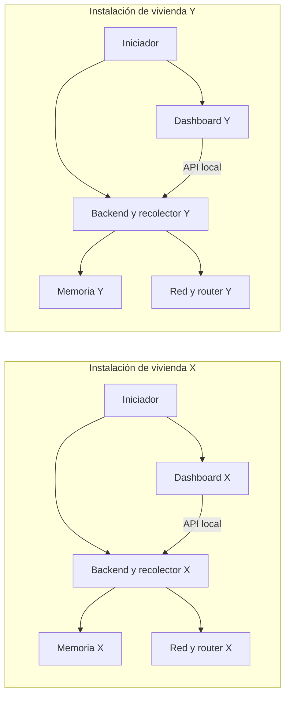
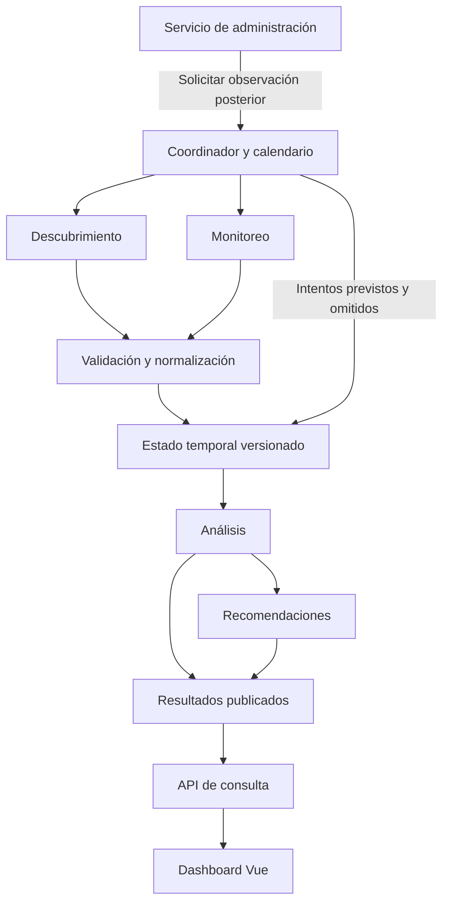

# Arquitectura inicial del sistema

La arquitectura deberá permitir observar una red doméstica, analizar automáticamente sus métricas, presentar información comprensible y ejecutar modificaciones compatibles cuando una persona las confirme y tenga autorización administrativa vigente.

## 1. Enfoque y entorno de ejecución

Se adopta una aplicación de instalación local por vivienda, con frontend web
Vue.js y backend modular Python comunicados mediante una API REST local. La
computadora instalada ejecuta el recolector y backend y muestra el dashboard;
puede ser el mismo ordenador que usa la persona para consultar y administrar.
La implementación del empaquetado y del iniciador está pendiente. El desarrollo
actual usa el CLI y no declara implementado el ciclo de aplicación instalada.

El iniciador deberá arrancar una única instancia de backend por instalación,
comprobar que esté preparada antes de mostrar el dashboard e informar fallos
de inicio. El cierre de la aplicación deberá detener sus tareas y procesos de
forma controlada. La sesión de navegador y el proceso de backend se tratarán
como ciclos de vida distintos; cerrar una pestaña no equivale a cerrar la aplicación.

En el MVP, la API se limitará al acceso desde la propia computadora, mediante
loopback. El acceso desde teléfonos es una ampliación: requerirá configurar
explícitamente acceso local, transporte y sesiones antes de exponer funciones
administrativas. No habrá apertura automática al exterior ni servidor central
para recolectar remotamente las redes de los visitantes.

Los componentes de cada instalación conservan estado separado. La igualdad de
IPs privadas, interfaz o gateway no identifica una vivienda: dos casas pueden
usar la misma configuración. Las series de análisis deberán distinguir también
instancia y sesión de recolección; la clave IPv4 actual solo compara configuración.

Los componentes del backend se organizarán por responsabilidades dentro de una misma aplicación. La separación entre módulos no exige desplegar servicios independientes. Los agentes serán componentes de software que ejecutan tareas delimitadas de descubrimiento, monitoreo y análisis; no requieren modelos de inteligencia artificial.

## 2. Componentes y responsabilidades

### 2.1. Interfaz web

El frontend en Vue.js presentará el dashboard, los dispositivos observados, las métricas, las condiciones detectadas y las recomendaciones.

La interfaz se comunicará con el backend; no consultará ni modificará directamente el router. Los controles visibles reflejarán las capacidades y permisos informados por el servidor. Su ocultamiento no sustituirá las comprobaciones de autorización.

### 2.2. API y servicios de consulta

La API recibirá las solicitudes del frontend, validará sus entradas y delegará su atención a los servicios correspondientes. Se distinguirán las operaciones de consulta, autorización y administración.

El servicio de consulta devolverá resultados previamente procesados, sin esperar a que finalice una nueva medición. Las respuestas incluirán los datos disponibles.

### 2.3. Agente de descubrimiento

Identificará interfaces, red local, puerta de enlace y dispositivos observables. Utilizará fuentes disponibles en el entorno y, cuando sea viable, consultas compatibles al router.

Producirá observaciones con fuente, momento de captura y campos disponibles de identificación. No garantizará una lista exhaustiva ni clasificará un dispositivo como malicioso o no autorizado por carecer de nombre.

### 2.4. Agente de monitoreo

Obtendrá mediciones periódicas hacia los destinos definidos y registrará su resultado y momento de captura. Diferenciará una respuesta, una ausencia de respuesta y un fallo al ejecutar la medición.

La implementación inicial deberá obtener los datos necesarios para los indicadores de conectividad establecidos en el alcance.

### 2.5. Validación y normalización

Esta responsabilidad compartida transformará las respuestas de las fuentes a representaciones internas consistentes. Verificará tipos, unidades, campos ausentes y errores, conservando la procedencia de los datos.

Los valores ausentes no se convertirán en ceros. La normalización no eliminará las limitaciones de la fuente ni convertirá datos incompletos en observaciones confirmadas.

### 2.6. Agente de análisis y recomendaciones

El agente de análisis calculará indicadores, comparará observaciones y evaluará reglas explícitas. Cada condición identificada conservará su relación con las mediciones, el periodo y el criterio aplicado.

El servicio de recomendaciones convertirá esos resultados en explicaciones y orientaciones comprensibles. Si una orientación se relaciona con una modificación, indicará su compatibilidad y necesidad de autorización. Ninguno de estos componentes ejecutará cambios por iniciativa propia.

### 2.7. Servicio de autorización

Gestionará la autorización temporal mediante credenciales administrativas del router. Tras una validación satisfactoria, asociará los permisos a una sesión del navegador y al router correspondiente, con una vigencia definida.

Se distinguirán tres elementos: la sesión de consulta de la aplicación, la autorización administrativa de esa sesión y la sesión técnica utilizada para comunicarse con el router. No se requieren cuentas propias, pero sí identificar las sesiones para aislar sus permisos.

### 2.8. Servicio de administración

Recibirá solicitudes de cambio de contraseña Wi-Fi, cambio de SSID, bloqueo y desbloqueo. Comprobará el soporte del adaptador, el objetivo, los parámetros, la confirmación y la autorización vigente antes de enviar cada operación.

Mantendrá un estado temporal de la operación y coordinará la verificación posterior. Evitará envíos duplicados de una misma solicitud y serializará las modificaciones sobre un router cuando su ejecución concurrente pueda producir resultados ambiguos.

La gestión de dispositivos bloqueados utilizará las restricciones disponibles en el router, sin depender de que esos dispositivos aparezcan en el descubrimiento de equipos conectados.

### 2.9. Coordinador de tareas

Gestionará el ciclo de vida de los agentes, su calendario y los límites de ejecución. Registrará las tareas previstas, ejecutadas, omitidas y fallidas para que la calidad de datos incluya también los intentos que no produjeron mediciones.

Coordinará la publicación de resultados y las solicitudes de observación posteriores a operaciones administrativas. Su funcionamiento se detalla en la sección 8.

### 2.10. Fuentes de red y adaptadores de router

Las fuentes de red encapsularán los mecanismos de descubrimiento y medición disponibles en el equipo recolector. Los adaptadores encapsularán los detalles de comunicación, autenticación, consultas y modificaciones propios del fabricante, modelo y firmware del router.

Cada adaptador declarará sus capacidades comprobadas, los parámetros necesarios y las condiciones de acceso. Una operación desconocida o no soportada no se presentará como disponible. La compatibilidad no se deducirá únicamente del proveedor de Internet.

Se definirán contratos comunes para consultar capacidades, autenticar, obtener información, ejecutar operaciones soportadas y comprobar resultados. Un adaptador no deberá simular el éxito de una función que no implementa.

### 2.11. Recolección local y permisos

Las fuentes del equipo (contexto IPv4, sondas y caché ARP cuando sea accesible)
y las fuentes del router se combinan conservando su origen y sus límites.
ARP describe asociaciones de la caché local, no un inventario completo del router.
Las consultas y modificaciones del router requieren un adaptador comprobado
para su modelo y firmware; no se presupone una interfaz universal.

Las credenciales del router autorizan acciones ante ese equipo. Los permisos del
sistema operativo autorizan al proceso recolector.
Los adaptadores del sistema operativo deberán declarar sus capacidades y fallos;
una lectura vacía no debe convertirse en una red sin equipos ni en un diagnóstico
confirmado de permisos.

## 3. Comunicación y tecnologías

| Relación o componente | Decisión inicial | Pendiente de concretar |
| --- | --- | --- |
| Interfaz | Vue.js | Versión, organización y biblioteca de visualización. |
| Backend | Python | Versión y framework de API. |
| Navegador y backend | API REST con respuestas estructuradas en JSON | Endpoints, esquemas, gestión de sesiones y despliegue seguro. |
| Actualización del dashboard | Consulta periódica de los últimos resultados como propuesta inicial | Intervalo según carga y frecuencia de las mediciones. |
| Componentes internos | Contratos de módulos y ejecución coordinada en segundo plano | Modelo de concurrencia y planificación. |
| Backend y router | Mecanismo específico comprobado en el equipo de prueba | Protocolo, autenticación, formato y operaciones soportadas. |
| Adquisición de datos | Bibliotecas elegidas según las fuentes y métricas | Evaluación de Scapy, PyShark, psutil e ICMP/ping contemplados en el proyecto. |
| Almacenamiento inicial | Estado temporal en memoria con retención acotada | Ventanas, límites y descarte de datos. |
| Persistencia posterior | MySQL contemplado en el protocolo | Modelo de datos e incorporación fuera del mínimo inicial. |

La API de la aplicación es distinta de la interfaz del router. No se presupone una API universal de Telmex ni la disponibilidad de SNMP. El frontend no conocerá endpoints internos, cookies ni tokens administrativos del router.

El transporte entre navegador y backend deberá proteger las credenciales cuando circule por la red local; se definirá HTTPS para ese acceso antes de habilitar operaciones administrativas. Las limitaciones del transporte disponible en el propio router deberán registrarse al investigar el equipo.

## 4. Flujo de observación

1. La persona abre la aplicación instalada; el iniciador prepara el backend local
   y muestra el dashboard cuando la API está disponible. Al iniciar el backend,
   el coordinador identifica el entorno y activa los agentes según las capacidades
   y configuración disponibles.
2. El descubrimiento obtiene observaciones de dispositivos y el monitoreo realiza las mediciones programadas.
3. La validación y normalización producen datos internos con su fuente, tiempo y estado.
4. El almacenamiento temporal conserva las observaciones necesarias para los cálculos y comparaciones.
5. El análisis calcula indicadores y condiciones; el servicio de recomendaciones genera las orientaciones aplicables.
6. El Invitado o Administrador consulta el dashboard y la API devuelve los últimos resultados procesados.
7. El proceso continúa sin requerir solicitudes individuales para descubrir, medir o analizar.

La consulta como Invitado utilizará exclusivamente la información permitida en ese contexto. Si una fuente requiere acceso administrativo y no existe una alternativa disponible, el indicador correspondiente se mostrará como no disponible. Los datos obtenidos en una operación privilegiada no pasarán automáticamente al estado compartido de consulta.

## 5. Flujo de administración y verificación

1. La persona selecciona una operación y su objetivo. El backend comprueba si está soportada.
2. Si la sesión no tiene autorización vigente, el servicio de autorización valida las credenciales mediante el adaptador compatible.
3. La interfaz muestra el cambio, el objetivo y los efectos previstos sobre la conectividad; la persona confirma la operación concreta.
4. El servicio de administración vuelve a comprobar autorización, compatibilidad y parámetros. La confirmación deberá corresponder al mismo objetivo y cambio que se enviarán.
5. El adaptador ejecuta la operación y devuelve el resultado inmediato, sin exponer secretos.
6. El servicio registra el estado temporal de la solicitud y coordina una nueva consulta para verificar su efecto.
7. La interfaz presenta el resultado y su nivel de verificación. La observación periódica continúa.

| Operación | Comprobación prevista |
| --- | --- |
| Cambiar contraseña Wi-Fi | Utilizar un mecanismo de comprobación compatible sin devolver la contraseña en respuestas ni registros. Si no puede comprobarse, informar esa limitación. |
| Cambiar SSID | Consultar el nombre configurado de la red o banda objetivo después del cambio. |
| Bloquear dispositivo | Comprobar la restricción aplicada y distinguirla del efecto observable sobre la conectividad. |
| Desbloquear dispositivo | Confirmar la retirada de la regla seleccionada; no confundirla con la reconexión efectiva del dispositivo. |

El estado de una operación distinguirá, como mínimo, solicitud recibida, rechazo, envío en curso, aceptación pendiente de verificación, efecto verificado y resultado incierto. Las transiciones precisas se definirán por operación.

Si la conexión se pierde después del envío, no se repetirá automáticamente la modificación. Se intentará consultar el estado cuando sea posible. Cerrar o expirar la autorización impide nuevos envíos, pero no revierte una operación ya recibida por el router.

## 6. Datos y estado temporal

| Información | Contenido conceptual | Alcance de conservación |
| --- | --- | --- |
| Entorno observado | Interfaz, red, puerta de enlace y fuentes disponibles | Ejecución del recolector. |
| Dispositivo observado | Identificación disponible, fuente, presencia y última observación | Ventana de observación definida. |
| Medición | Origen, destino, valor, unidad, tiempo y resultado | Ventana necesaria para cálculo y comparación. |
| Indicador y condición | Resultado, periodo, vigencia, regla y referencias a observaciones | Estado actual y retención acotada. |
| Recomendación | Explicación, condición asociada y posible acción | Mientras conserve vigencia. |
| Capacidades del router | Modelo, firmware, funciones y limitaciones verificadas | Configuración y comprobaciones del adaptador. |
| Autorización | Sesión, router, permisos, vigencia y estado | Hasta cierre, expiración o reinicio. |
| Operación administrativa | Identificador, sesión, router, objetivo, estado y verificación, sin secretos | Seguimiento temporal de la operación. |

La sesión de recolección y la sesión del navegador son distintas. Cerrar un navegador no deberá detener el monitoreo compartido. Terminar la autorización no eliminará las observaciones públicas ni los permisos de otras sesiones.

Un reinicio del backend perderá el estado en memoria e invalidará las autorizaciones. No implicará deshacer cambios en el router. Después de reiniciar se observará el estado real y no se reenviarán modificaciones anteriores como si fueran nuevas.

La retención de observaciones estará acotada; no se exige historial entre ejecuciones. Los secretos se mantendrán fuera de las estructuras públicas y solo durante el tiempo necesario. Una futura persistencia deberá incorporarse mediante una responsabilidad de almacenamiento separada de los cálculos y adaptadores.

## 7. Manejo de fallos y protección de operaciones

- Cada fuente tendrá un estado identificable. Un fallo parcial no deberá detener toda la aplicación ni invalidar los datos de fuentes independientes.
- Las consultas tendrán tiempos de espera y reintentos limitados. Las modificaciones no compartirán una política de reintento ciego con las lecturas.
- El último dato válido conservará su momento de captura; su vigencia se evaluará según los criterios de métricas.
- Las entradas de la API se validarán antes de llegar al adaptador. El backend comprobará permisos en cada modificación y limitará las operaciones a las capacidades implementadas.
- Las sesiones administrativas deberán protegerse frente a solicitudes ajenas a la sesión autorizada, incluyendo protección frente a solicitudes cruzadas si se utilizan cookies.
- Las credenciales y tokens no aparecerán en registros, respuestas de consulta ni evidencias. La contraseña Wi-Fi nueva tampoco formará parte del registro público del resultado.
- Las evidencias compartidas se anonimizarán. Los mensajes al usuario explicarán la limitación sin divulgar detalles sensibles de autenticación.

## 8. Arquitectura de los agentes

### 8.1. Organización y límites

Los agentes de descubrimiento, monitoreo y análisis serán módulos del backend Python coordinados en segundo plano. Compartirán contratos de datos definidos y un almacenamiento temporal controlado. Inicialmente no requieren procesos distribuidos, un intermediario de mensajes ni una instalación por dispositivo observado.

El coordinador decidirá cuándo ejecutar las tareas; los agentes realizarán su trabajo y devolverán resultados. La API consultará los resultados publicados sin iniciar una nueva recolección por cada petición o navegador conectado.

La autorización y la administración permanecerán como servicios separados. Ningún agente de observación o análisis podrá bloquear dispositivos o cambiar configuraciones por iniciativa propia.

### 8.2. Agente de descubrimiento

| Elemento | Definición |
| --- | --- |
| Objetivo | Obtener observaciones de dispositivos y del entorno local, identificando la cobertura real de cada ciclo. |
| Entradas | Identificador del entorno, interfaz, ámbito autorizado, fuente o adaptador compatible, configuración y plazo máximo del ciclo. |
| Salida | Un resultado de descubrimiento con identificador de ciclo, fuente, ámbito, tiempos, estado de finalización y lista de observaciones. |
| Datos por observación | Identificador contextual, IP, MAC y otros campos disponibles, fuente y momento de captura. Los campos ausentes permanecerán explícitamente vacíos. |
| Ejecución | Al iniciar la observación y, como propuesta piloto, cada 30 s. No habrá dos ciclos simultáneos de la misma fuente sobre el mismo ámbito. |
| Límite | No determina consumo, autorización de acceso ni intención del dispositivo a partir de su identidad. |

Se distinguirá un ciclo **completo**, **parcial**, **fallido** o **cancelado**. Completo significa que terminó el método previsto para el ámbito declarado; no garantiza haber encontrado todos los dispositivos conectados.

Los resultados parciales podrán aportar evidencia positiva de los dispositivos encontrados, pero no se utilizarán para inferir ausencia de los restantes. Un ciclo fallido no reemplazará el inventario por una lista vacía. La comparación de presencia corresponderá al agente de análisis.

Si cambia la red, interfaz o método, se abrirá un nuevo contexto de observación. La primera lista de ese contexto será una referencia inicial y no un evento de conexión simultánea de todos sus dispositivos.

### 8.3. Agente de monitoreo

| Elemento | Definición |
| --- | --- |
| Objetivo | Obtener intentos de medición y, cuando existan fuentes compatibles, lecturas de contadores. |
| Entradas | Entorno, interfaz, destinos autorizados, método, identificador de intento, instante programado, tiempo de espera y fuente. |
| Salida | Resultado por intento con tiempos de envío y respuesta cuando existan, resultado, destino, fuente y error clasificado. Para contadores: entidad, dirección, valor, unidad y tiempo de lectura. |
| Ejecución | Sondas cada 5 s por destino, con espera piloto de 1 s. Contadores cada 5 s únicamente si se habilita una fuente; usar el intervalo real entre lecturas. |
| Límite | No interpreta una ausencia de respuesta como caída general ni atribuye los contadores locales a otros dispositivos. |

Los resultados de sondas distinguirán **respuesta válida**, **sin respuesta**, **error de recolección** y **cancelado**. El coordinador registrará además los intentos **omitidos** que estaban programados pero no pudieron iniciarse.

Un intento enviado cuyo plazo terminó sin respuesta será evidencia para disponibilidad observada, aunque no produzca un RTT. Un error de permisos o de ejecución será un fallo de recolección. Los datos conservarán esa diferencia hasta el dashboard.

Se asociarán respuestas e intentos para evitar duplicados. Una respuesta tardía no se contará como recibida dentro del plazo ni renovará artificialmente el instante de una medición anterior. Los tiempos de duración pertenecerán al mismo reloj monotónico.

### 8.4. Agente de análisis

| Elemento | Definición |
| --- | --- |
| Objetivo | Transformar observaciones normalizadas en indicadores y condiciones sustentadas en los datos. |
| Entradas | Una versión consistente del estado temporal, calendario de intentos, configuración de métricas, ventanas, criterios de vigencia y reglas habilitadas. |
| Salida | Indicadores con valor, unidad, ámbito, periodo, calidad y referencias de entrada; condiciones con regla, parámetros y evidencia. |
| Ejecución | Tras publicar nuevos resultados y en revisiones temporales de calidad. No envía sondas ni consulta directamente al router. |
| Límite | No inventa valores, no clasifica dispositivos por identidad y no ejecuta recomendaciones. |

Para M-04 comparará ciclos completos del mismo contexto. Como criterio piloto, tres ciclos completos consecutivos sin observación permitirán informar ausencia reciente. Un ciclo parcial, fallido, cancelado u omitido interrumpirá esa racha y reiniciará el contador; no confirmará ausencia. Una observación positiva actualizará la última presencia incluso si proviene de un ciclo parcial.

Para M-05 utilizará también el calendario del coordinador: no basta con contar las mediciones recibidas para conocer cuántas debieron realizarse. La salida distinguirá calidad insuficiente de un resultado de conectividad desfavorable.

El análisis producirá condiciones solo cuando existan reglas configuradas y evidencia suficiente. El servicio de recomendaciones utilizará esas condiciones y las capacidades del router para generar orientaciones; no repetirá la adquisición ni concederá privilegios.

### 8.5. Contratos comunes de datos

| Contrato | Contenido mínimo |
| --- | --- |
| Contexto de observación | Identificador de ejecución y entorno, interfaz, ámbito de red y versión de configuración. |
| Tarea programada | Identificador único, agente, fuente, objetivo, instante previsto, plazo y estado de ejecución. |
| Resultado de descubrimiento | Ciclo, contexto, fuente, inicio/fin, cobertura declarada, finalización completa/parcial/fallida/cancelada y observaciones. |
| Resultado de sonda | Intento y posición del calendario, origen/destino, método, tiempos, resultado y RTT cuando sea válido. |
| Lectura de contador | Entidad, fuente, dirección, contador, unidad, tiempo y referencia de generación o reinicio cuando esté disponible. |
| Indicador | Identificador M-01 a M-08, ámbito, valor o ausencia, unidad, ventana, muestras utilizadas, calidad y versión de entradas. |
| Condición detectada | Identificador, regla y versión, parámetros, periodo, indicadores asociados y evidencia que sustenta la interpretación. |
| Error de fuente | Categoría, tarea afectada, momento, alcance del fallo y mensaje sin secretos. |

Cada resultado conservará su origen y contexto de acceso. Los resultados restringidos a una sesión autorizada no se mezclarán con los destinados al Invitado. Las credenciales y tokens no formarán parte de estos contratos compartidos; el adaptador recibirá el contexto autorizado mediante el servicio correspondiente.

La validación verificará formato y campos obligatorios antes de incorporar una salida al estado temporal. El análisis recibirá contratos normalizados, no respuestas específicas de un fabricante.

### 8.6. Coordinación y publicación de resultados

1. El coordinador registra una tarea antes de ejecutarla, de modo que los fallos y omisiones también sean observables.
2. Entrega la tarea al agente con su contexto y plazo. Las operaciones de entrada/salida se ejecutan fuera del camino que atiende consultas de la API.
3. El agente devuelve un resultado identificado. La validación acepta las partes utilizables y conserva los errores o la cobertura parcial.
4. El almacenamiento incorpora el resultado una sola vez mediante su identificador y publica una nueva versión consistente.
5. El análisis lee una versión de las entradas y calcula los resultados correspondientes; las recomendaciones se asocian a esa misma evidencia.
6. Los resultados se publican como una unidad consistente. Una ejecución antigua de análisis no podrá sobrescribir una versión más reciente.
7. La API devuelve el último resultado publicado y su calidad. Una consulta no renueva las marcas de captura.

La propuesta inicial utiliza un único coordinador y un límite configurable de tareas simultáneas. El mecanismo concreto de ejecución en segundo plano se elegirá con el framework del backend; si se añaden varios procesos de servidor, deberá mantenerse un único responsable de la planificación para evitar recolectores duplicados.

No habrá una cola ilimitada. Si una tarea sigue activa cuando vence la siguiente, el coordinador registrará la omisión o aplazamiento sin ejecutar una ráfaga de tareas atrasadas. El análisis podrá agrupar notificaciones pendientes y procesar la versión más reciente, conservando los registros necesarios para calcular las ventanas.

### 8.7. Periodicidad, vigencia y almacenamiento

Los parámetros de medición se mantendrán en una configuración común basada en [metricas.md](metricas.md), evitando valores distintos en cada agente.

| Actividad | Propuesta inicial |
| --- | --- |
| Descubrimiento | Cada 30 s; sin ciclos superpuestos por fuente y ámbito. |
| Sondas por destino | Cada 5 s; espera de 1 s. |
| Lectura de contadores habilitados | Cada 5 s; duración real del intervalo para los cálculos. |
| Ventana de conectividad | 60 s. |
| Análisis | Con nuevas entradas, agrupando ejecuciones pendientes. |
| Revisión de vigencia | Cada 5 s como propuesta del coordinador, incluso si no llegan muestras nuevas. |
| Vigencia de conectividad | 15 s según el resultado relevante para cada indicador. |
| Vigencia de inventario | 90 s desde el último ciclo utilizable. |
| Retención de observaciones | 10 min en memoria. |

La revisión de calidad permitirá marcar datos como antiguos aunque una fuente deje de producir resultados. La API comprobará además la antigüedad al responder para no mostrar como vigente una publicación cuyo análisis haya dejado de actualizarse.

El estado temporal será administrado por un componente común con acceso controlado; los agentes no modificarán libremente estructuras compartidas. Mantendrá observaciones, tareas y resultados diferenciados y filtrados por contexto de acceso. Las actualizaciones del inventario y de los indicadores se publicarán de forma consistente.

La retención también tendrá límites de cantidad acordes con el número de destinos y dispositivos soportados, por definir en las pruebas. Si el descarte anticipado impide completar una ventana, se informará calidad insuficiente. Tras agotar la retención de un dispositivo, no se prometerá reconocer una reaparición basada en un historial ya eliminado.

### 8.8. Fallos y recuperación de los agentes

| Situación | Comportamiento previsto |
| --- | --- |
| Fuente no soportada o permisos insuficientes | Marcar la capacidad como no disponible o bloqueada, informar el motivo y evitar intentos continuos hasta corregir la configuración. |
| Timeout de una sonda enviada | Registrar sin respuesta; no tratarlo como RTT cero ni como error local de envío. |
| Ciclo de descubrimiento parcial | Incorporar evidencia positiva y no usar las ausencias para confirmar cambios de presencia. |
| Fuente temporalmente inaccesible | Conservar los últimos datos con su antigüedad y reintentar lecturas con límites configurados. |
| Datos mal formados | Rechazar los campos o registros inválidos, conservar el diagnóstico y evitar cálculos sobre valores ficticios. |
| Excepción del análisis | Conservar la última publicación con su fecha e informar el fallo de actualización; no detener las fuentes independientes. |
| Resultado duplicado o de otro contexto | No contabilizarlo nuevamente ni incorporarlo a la ventana activa incorrecta. |
| Cambio de red o reinicio | Crear contexto nuevo, limpiar comparaciones incompatibles e iniciar ventanas nuevas. |

En las sondas piloto no se realizarán reintentos ocultos dentro del mismo intervalo. Un intento omitido o cancelado no se convertirá en ausencia de respuesta. Las políticas adicionales de reintento de lectura se documentarán antes de habilitarlas, sin inflar la cobertura de M-05.

Al detener el backend, el coordinador dejará de programar tareas y finalizará o cancelará las pendientes dentro de sus plazos. Las tareas canceladas conservarán ese estado; no se considerarán mediciones completadas.

### 8.9. Comprobaciones previas a la integración

La implementación de estos contratos deberá permitir comprobar con fuentes de prueba:

- Una respuesta, un timeout y un error de permisos producen resultados distintos.
- Un ciclo parcial o fallido no confirma la ausencia de dispositivos.
- Los duplicados no incrementan conteos ni cobertura.
- El análisis utiliza entradas conocidas y conserva la evidencia de sus condiciones.
- Las marcas de vigencia cambian aunque no lleguen datos nuevos.
- Varias visitas al dashboard no crean recolectores adicionales.
- Un cambio de entorno no mezcla ventanas ni identidades de la red anterior.
- Las observaciones administrativas restringidas no aparecen en consultas de Invitado.
